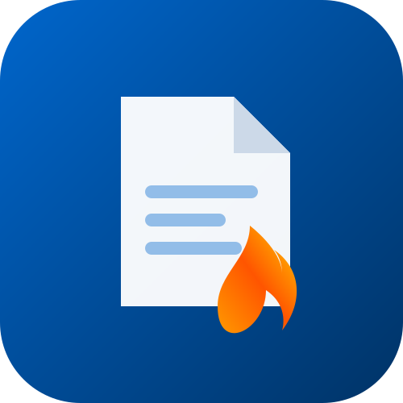

<p align="center">
  
</p>

<h1 align="center">ComgasCraft</h1>

<p align="center">
  <b>Automação inteligente e de alta velocidade para consulta, download em lote e renomeação padronizada de 2ª via de faturas da Comgás.</b>
</p>

<p align="center">
  
  
  
  
</p>

---

## 💡 Sobre o Projeto

O **ComgasCraft** resolve o processo manual, repetitivo e lento de acessar o portal de autoatendimento da Comgás para consultar e baixar faturas de múltiplos medidores prediais/condominiais.

### ✨ Principais Recursos:
- **Fluxo 100% Automatizado:** Login via CNPJ/Código, navegação até o extrato e captura do PDF.
- **Evasão Anti-Bot & Angular Reativo:** Desativação de flags de automação para liberar o reCAPTCHA invisível e digitação humanizada sequencial para acionar os formulários dinâmicos.
- **Renomeação Padronizada Imediata:** Salva cada fatura identificada diretamente com a nomenclatura de bloco e medidor (`Fatura_Comgas_A1_30267218.pdf`).
- **Navegador em Modo Visível (Headed):** Acompanhe toda a execução na tela em tempo real.
- **Segurança & Privacidade:** Credenciais e códigos de medidores isolados via `.env` e `medidores.json` protegidos pelo `.gitignore`.

---

## 🛠️ Instalação e Requisitos

1. Clone o repositório:
   ```bash
   git clone https://github.com/Henrique1601/ComgasCraft.git
   cd ComgasCraft
   ```

2. Instale as dependências:
   ```bash
   pip install -r requirements.txt
   playwright install chromium
   ```

---

## ⚙️ Configuração

1. Copie o arquivo `.env.example` para `.env`:
   ```bash
   cp .env.example .env
   ```
   E defina o seu CNPJ ou CPF:
   ```env
   COMGAS_CNPJ=20347072000117
   ```

2. Crie ou configure seu arquivo `medidores.json` (use `medidores.example.json` como base):
   ```json
   [
     {"bloco": "A1", "codigo": "30267218"},
     {"bloco": "A2", "codigo": "30461499"}
   ]
   ```

---

## 🚀 Como Executar

Execute o script principal:
```bash
python automacao_comgas.py
```

Os arquivos baixados e renomeados estarão organizados dentro da pasta `faturas/`.

---

## 📄 Licença

Este projeto está sob a licença [MIT](LICENSE).
